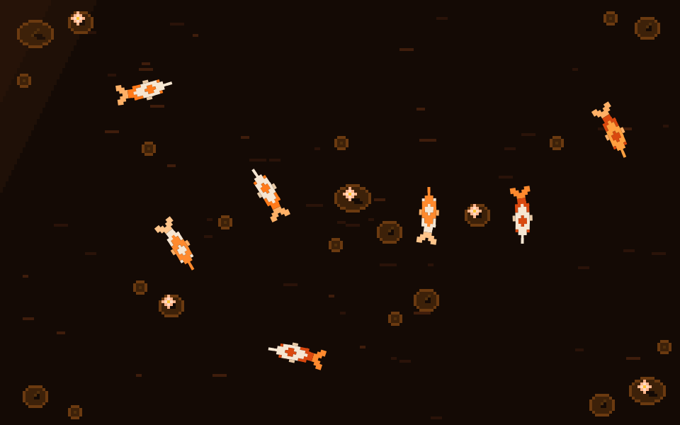

# orange-kois

An animated theme for the Code tab of the Claude desktop app. It recolors the app in warm orange on near-black and paints a pixel-art koi pond behind your conversation. Under the hood it is a Claude Code [mod](https://code.claude.com/docs/en/plugins/mods/overview) packaged as a plugin.

## Themes

| Theme | What it is |
| --- | --- |
| [orange-kois](themes/orange-kois) | A dark pond seen from above: seven orange-and-white pixel koi on curved routes that never cross, amber lily pads in loose clusters, and ripples and soft light drifting with a slow current. Made for dark mode. |

## Setup

You need the Claude desktop app, updated to the latest version, with Claude Code 2.1.325 or later in its Code tab. To check, run `/status` in a Code tab session and read the **Claude Code** row.

Install the theme from this repository. At the prompt of a terminal session:

```
/plugin install orange-kois --marketplace nabielyr/orange-kois
```

From a shell:

```
claude plugin install orange-kois --marketplace nabielyr/orange-kois
```

In the desktop app, where `/plugin` does not run: click **+** next to the prompt box, then **Plugins**, **Add marketplace** with `nabielyr/orange-kois`, then **Add plugin**.

Then start a new session. The theme appears once that session has sent its first message.

## Use

| Command | What it does |
| --- | --- |
| `/orange-kois off` | Turns the theme off and gives the app its own look back. It stays off in later sessions. |
| `/orange-kois on` | Turns it back on |

A session shows one theme at a time, so keep one theme mod on at a time.

The scene holds still if your system asks for reduced motion.

## Develop

The theme is the folder [`themes/orange-kois`](themes/orange-kois), listed in [`.claude-plugin/marketplace.json`](.claude-plugin/marketplace.json). To work on it, link it into your skills directory, where Claude Code loads it in every new session with no install step:

```bash
ln -s "$PWD/themes/orange-kois" ~/.claude/skills/orange-kois
```

Then check it from the repository root:

```bash
claude plugin validate themes/orange-kois
claude plugin test themes/orange-kois
```

[The theme's README](themes/orange-kois/README.md#how-it-works) explains how the scene is built.

Built with Claude Code 2.1.325. Mods are an early-access API and may change between releases.

## License

[MIT](LICENSE)
